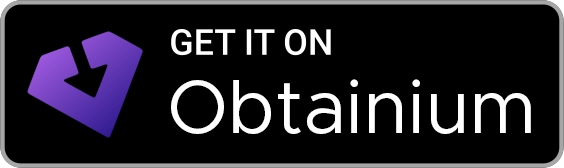

# MarkTube

**MarkTube** is a lightweight Android app for watching YouTube without ads, with background
playback and SponsorBlock. It's a small, focused browser built on Mozilla's
[GeckoView](https://mozilla.github.io/geckoview/) (the Firefox engine) that opens the mobile website
`m.youtube.com`. It contains no YouTube code and no modified YouTube app.

Created by **Marko Stevanović** ([@alertpay91](https://github.com/alertpay91)).

<p>
  <a href="https://apps.obtainium.imranr.dev/redirect?r=obtainium%3A%2F%2Fapp%2F%257B%2522id%2522%253A%2522com.marko.slimtube%2522%252C%2522url%2522%253A%2522https%253A%252F%252Fgithub.com%252Falertpay91%252FMarkTube%2522%252C%2522author%2522%253A%2522alertpay91%2522%252C%2522name%2522%253A%2522MarkTube%2522%257D"></a>
  &nbsp;
  <a href="https://github.com/alertpay91/MarkTube/releases/latest/download/MarkTube.apk"><b>⬇ Download MarkTube.apk</b></a>
</p>

- [🇷🇸 Uputstvo za instalaciju (srpski)](#-uputstvo-za-instalaciju)
- [🇬🇧 How to install (English)](#-how-to-install)
- [⚠ Preuzimanje / Downloading](#-preuzimanje--na-sopstvenu-odgovornost)
- [iPhone](#iphone)

## 🇷🇸 Uputstvo za instalaciju

MarkTube je mala Android aplikacija za gledanje YouTube-a:
- bez reklama,
- sa puštanjem u pozadini i na zaključanom ekranu,
- sa preskakanjem sponzorisanih delova u videima,
- sa tabom **Preuzmi** za snimke koje smeš da preuzmeš (vidi [upozorenje](#-preuzimanje--na-sopstvenu-odgovornost)).

Preporučeni način je preko aplikacije **Obtainium**. Ona besplatno i bezbedno skida aplikacije
direktno sa GitHub-a i sama ih ažurira. Tako se MarkTube ažurira sam, bez ikakvog truda.

### 1. Instaliraj Obtainium

1. Na telefonu otvori
   [Obtainium izdanja](https://github.com/ImranR98/Obtainium/releases/latest).
2. Pod **Assets** preuzmi fajl **`app-arm64-v8a-release.apk`**.
3. Otvori preuzeti fajl i dodirni **Instaliraj**.
   - Ako telefon pita, dozvoli instaliranje iz pretraživača (Chrome).
   - Taj korak traži „Install unknown apps“ dozvolu.

### 2. Dodaj MarkTube u Obtainium

1. Na telefonu otvori ovu stranicu i dodirni dugme **Get it on Obtainium** na vrhu.
2. Obtainium se otvori. Dodirni **Continue**, pa **Add**.

Ako dugme ne radi, uradi isto ručno:
1. U Obtainium-u dodirni **+ Add**.
2. U polje **App source URL** nalepi `https://github.com/alertpay91/MarkTube`.
3. Dodirni **Add**.

### 3. Instaliraj MarkTube

1. U Obtainium-u dodirni dugme za preuzimanje pored MarkTube-a.
2. Prvi put Android traži dve potvrde:
   - **Allow from this source**: uključi, pa se vrati nazad.
   - **Google Play Protect** (*App scan recommended*): izaberi **Scan app**. Kad piše
     *This app looks safe*, dodirni **Install**.
3. Otvori MarkTube. Ako želiš svoje pretplate, prijavi se na Google nalog (dodirni **You**).

### 4. Ažuriranja

- **Aplikacija:** Obtainium sam proverava nove verzije na svakih nekoliko sati i instalira ih u
  pozadini, bez pitanja.
  - Ako ne želiš da troši mobilne podatke (ažuriranje ima oko 95 MB), otvori Obtainium →
    ⚙️ → **Updates** → **When not on Wi-Fi** → **Check only**.
- **Blokator reklama i SponsorBlock:** ažuriraju se sami pri svakom pokretanju MarkTube-a.

### Bez Obtainium-a

1. Preuzmi [MarkTube.apk](https://github.com/alertpay91/MarkTube/releases/latest/download/MarkTube.apk).
2. Instaliraj ga isto kao u koraku 3.

MarkTube će ti poslati obaveštenje kad izađe nova verzija, ali ćeš je instalirati ručno.

### Česta pitanja

- **Da li je bezbedno?** Da.
  - Kod je javan, ovde na GitHub-u.
  - Aplikaciju pravi GitHub automatski iz tog koda.
  - Google Play Protect je skenira i označava kao bezbednu.
  - MarkTube ne skuplja nikakve podatke.
- **Da li troši bateriju u pozadini?** Ne. Kad ništa ne pušta, aplikacija miruje.
- **Koji telefon treba?** Android 8.0 ili noviji, sa 64-bitnim procesorom. To su skoro svi
  telefoni iz poslednjih nekoliko godina.

## 🇬🇧 How to install

The recommended way is **Obtainium**, a free, open-source app that installs apps straight from
GitHub and keeps them updated in the background.

1. **Install Obtainium:**
   1. Open [Obtainium releases](https://github.com/ImranR98/Obtainium/releases/latest) on your phone.
   2. Download `app-arm64-v8a-release.apk` and install it.
   3. Allow installs from your browser if asked.
2. **Add MarkTube:**
   1. On your phone, tap the **Get it on Obtainium** badge above.
   2. Tap **Continue**, then **Add**.
   - Manual alternative: tap **+ Add** in Obtainium, paste `https://github.com/alertpay91/MarkTube`
     and tap **Add**.
3. **Install:**
   1. Tap the download button next to MarkTube.
   2. The first time, Android asks you to allow installs from Obtainium.
   3. Play Protect may recommend a scan: choose **Scan app**, then **Install**.
4. **Updates:**
   - **The app:** after the first install, Obtainium updates MarkTube silently in the background.
   - **The blocker extensions:** they update themselves every time MarkTube starts.

Without Obtainium, download
[MarkTube.apk](https://github.com/alertpay91/MarkTube/releases/latest/download/MarkTube.apk) and
install it. MarkTube will show a notification when a new version is out.

Requires Android 8.0+ on a 64-bit ARM (arm64-v8a) phone.

## ⚠ Preuzimanje — na sopstvenu odgovornost

MarkTube ima tab **Preuzmi** (u donjoj traci, i u meniju „Deli“ kao *Preuzmi (MarkTube)*).
Snimak ili samo zvuk preuzima pomoću programa [yt-dlp](https://github.com/yt-dlp/yt-dlp), a fajl
čuva u folderu **Download/MarkTube**.

**Korisnik preuzima na sopstvenu odgovornost i sme da preuzima samo ono što ima pravo da
preuzme**, na primer:

- svoje snimke,
- snimke čiji je autor izričito dozvolio preuzimanje,
- sadržaj sa slobodnom licencom (npr. Creative Commons) ili u javnom domenu.

Preuzimanje tuđe muzike, filmova i drugih snimaka bez dozvole može da krši autorska prava i
YouTube uslove korišćenja. Poštuj zakone svoje zemlje. Pre svakog preuzimanja aplikacija prikaže
licencu snimka i traži da potvrdiš da imaš pravo da ga preuzmeš. Zaštićeni (DRM) i plaćeni
sadržaji se ne preuzimaju. Autori MarkTube-a ne odgovaraju za to šta korisnici preuzimaju niti
kako to koriste.

### Downloading — at your own risk (English)

MarkTube has a **Preuzmi** (Download) tab, also offered in the share menu. It downloads a video
or just its audio with [yt-dlp](https://github.com/yt-dlp/yt-dlp) into **Download/MarkTube**.
**You download at your own risk and only what you are allowed to download**: your own uploads,
videos whose author permits it, or freely licensed (e.g. Creative Commons) / public-domain
content. Downloading other people's music or videos without permission may infringe copyright and
YouTube's Terms of Service. Before each download the app shows the video's licence and asks you to
confirm you have the right to download it. DRM-protected and paid content is not downloaded. The
authors of MarkTube are not responsible for what users download or how they use it.

## iPhone

There is no iPhone version. Apple doesn't allow a custom browser engine with extensions like
this. You can get close in Safari, though:

1. Install **uBlock Origin Lite** (free, iOS 18+) from the App Store.
2. Turn it on in **Settings → Apps → Safari → Extensions**.
3. Optionally, add **SponsorBlock for Safari** (paid) from the App Store.
4. Open `m.youtube.com` in Safari itself. Don't use "Add to Home Screen": extensions don't run
   there.
5. For background audio:
   1. Start the video.
   2. Lock the screen.
   3. Press play on the lock screen.

## Features

- **No ads:** [uBlock Origin](https://addons.mozilla.org/firefox/addon/ublock-origin/) is installed
  automatically, and sponsored Shorts are skipped.
- **SponsorBlock:** [SponsorBlock](https://addons.mozilla.org/firefox/addon/sponsorblock/) skips
  sponsor segments inside videos.
- **Background and lock-screen playback:** a media notification with play/pause, next, previous
  and a seek bar.
- **Native feel:**
  - The back button closes menus, comments and dialogs first, then steps back through history.
  - In Shorts, back goes to the previous short.
  - A tab bar (Home / Shorts / Subscriptions / You) stays visible on Shorts.
- **Fullscreen:** turns landscape automatically.
- **Opens YouTube links** shared from other apps.
- **Pull to refresh:** pull down at the top of Home, Subscriptions or a channel to reload it. The
  feed also reloads by itself when you come back after 20 minutes or more.
- **Download tab** (at your own risk, only content you may download, see
  [above](#-preuzimanje--na-sopstvenu-odgovornost)): video up to 720p/1080p or audio only, via
  yt-dlp. yt-dlp updates itself once a day; there is no ffmpeg, the video and audio streams are
  joined with Android's MediaMuxer.
- **Stays up to date:**
  - Browser extensions update from addons.mozilla.org on every start.
  - The app updates through Obtainium.
- **Automatic builds:** GitHub Actions rebuilds the app every week with the newest GeckoView, so
  the engine's security fixes keep arriving.

MarkTube itself never downloads or installs APKs.

## Build it yourself

```sh
./gradlew assembleRelease
```

- Release signing reads `keystore.properties` (`storeFile`, `storePassword`, `keyAlias`,
  `keyPassword`), which is not part of this repository.
- CI gets the key from repository secrets: `KEYSTORE_BASE64`, `STORE_PASSWORD`, `KEY_ALIAS` and
  `KEY_PASSWORD`.
- Release tags are `v1.<versionCode>`, matching the app's version name, so Obtainium detects
  versions correctly.

## Disclaimer

MarkTube is an independent, non-commercial project and is **not affiliated with, endorsed by,
or sponsored by YouTube or Google**. "YouTube" is a trademark of Google LLC. MarkTube does not
include or modify any YouTube software and does not redistribute videos. It displays the public
mobile website the way any web browser does. The optional download tab only fetches what the user
asks for, on the user's own device and responsibility, and is meant only for content the user is
allowed to download. Use it in line with the law and the terms of the services you use.

## License

- MarkTube's own code is released under the [MIT License](LICENSE).
- GeckoView is © Mozilla and licensed under the [Mozilla Public License 2.0](https://www.mozilla.org/MPL/2.0/).
- The download tab uses [youtubedl-android](https://github.com/yausername/youtubedl-android)
  (GPL-3.0), which bundles Python (PSF License), QuickJS (MIT) and
  [yt-dlp](https://github.com/yt-dlp/yt-dlp) (Unlicense). Because of that library, the APK as a
  whole is distributed under the GPL-3.0; MarkTube's own source code stays MIT.
- uBlock Origin, SponsorBlock and Video Background Play Fix are
  downloaded at runtime from addons.mozilla.org. They belong to their authors and keep their own
  licenses.
- The "Get it on Obtainium" badge comes from the
  [Obtainium](https://github.com/ImranR98/Obtainium) project (GPL-3.0), which invites projects to
  use it.
